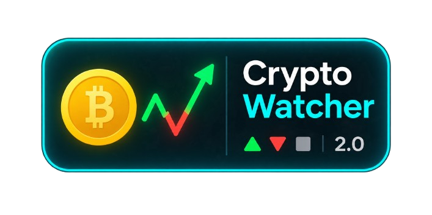

<p align="center">
  
</p>

# 📈 Crypto Watcher 2.0

Tableau de bord des cryptomonnaies en temps réel, pensé pour être lu en 3 secondes, même par un non-initié.
Projet pédagogique CDA, Live Campus. JavaScript pur, aucune dépendance.

> Seconde version du Crypto Watcher réalisé en janvier 2026 : mêmes fonctionnalités, code plus robuste et entièrement modulaire.

**🌐 Démo en ligne : <https://cryptowatcher-2-0.netlify.app/>**
**Statut : terminé et déployé (16 octobre 2026)**

---

## Sommaire

1. [Aperçu](#aperçu)
2. [Fonctionnalités](#fonctionnalités)
3. [Technologies](#technologies)
4. [Démo et lancement](#démo-et-lancement)
5. [Utilisation](#utilisation)
6. [Architecture](#architecture)
7. [Robustesse](#robustesse)
8. [Accessibilité](#accessibilité)
9. [Personnalisation](#personnalisation)
10. [Choix techniques](#choix-techniques)
11. [Évolutions possibles](#évolutions-possibles)
12. [Apprentissages](#apprentissages)
13. [Auteure](#auteure)

---

## Aperçu

Chaque cryptomonnaie est une **carte** qui répond à une seule question :
_« ça monte ou ça descend, et de combien ? »_

Une carte affiche :

- le nom et le symbole de la crypto
- le prix actuel dans la devise choisie
- une pastille de variation : ▲ hausse · ▼ baisse · ■ stable
- un mini-graphique de l'évolution depuis l'ouverture de la page
- un panneau « Détails » : plus haut, plus bas, derniers prix

Design inspiré des écrans de trading (fond sombre, couleurs vives), avec une légende explicite pour les débutants. Interface **mobile first**.

---

## Fonctionnalités

| Fonctionnalité      | Détail                                                                           |
| ------------------- | -------------------------------------------------------------------------------- |
| Prix en temps réel  | API publique Coinbase, mise à jour toutes les 5 s                                |
| Variation           | Pastille ▲ / ▼ / ■ : l'information ne repose jamais sur la couleur seule         |
| Graphique           | Sparkline SVG, évolution depuis l'ouverture de la page                           |
| Historique          | Derniers prix par crypto, sans doublon consécutif                                |
| Statistiques        | Plus haut et plus bas de la session                                              |
| Ajout de crypto     | Saisie libre **ou** liste déroulante de suggestions, vérifiée auprès de Coinbase |
| Suppression         | Bouton ✕ sur chaque carte                                                        |
| Devise              | Bascule EUR / USD                                                                |
| Thème               | Sombre / clair, suit le système au premier lancement                             |
| Persistance         | Cryptos suivies, devise et thème mémorisés (`localStorage`)                      |
| Statut de connexion | Indicateur « En direct » / erreur, sans popup                                    |
| Identité visuelle   | Logo dans l'en-tête et favicon                                                   |

Cryptos suivies par défaut : BTC, ETH, ADA, DOT, CRO, POL.
Suggestions proposées : SOL, XRP, DOGE, LTC, LINK, AVAX, UNI, ATOM.

---

## Technologies

- **HTML5** : structure sémantique
- **CSS3** : variables (tokens), un fichier par composant, mobile first
- **JavaScript ES6+** : modules natifs, `fetch`, `async/await`
- **API Coinbase** : `https://api.coinbase.com/v2/prices/{SYMBOL}-{DEVISE}/spot`
- **Zéro dépendance externe, aucune étape de build**

---

## Démo et lancement

### En ligne

Application déployée : **<URL-DU-DEPLOIEMENT>**

Le site est statique (HTML, CSS, JS) : tout hébergeur de fichiers statiques convient (GitHub Pages, Netlify, Vercel…). Aucune configuration serveur ni clé d'API n'est nécessaire.

### En local

Les modules ES exigent un serveur local (l'ouverture directe via `file://` ne fonctionne pas).

```bash
# Option 1
npx serve

# Option 2
python3 -m http.server 8000
```

Puis ouvrir l'adresse affichée (par exemple http://localhost:8000).

**Réinitialiser l'application** : supprimer la clé `cw2` du `localStorage` dans les outils de développement du navigateur.

---

## Utilisation

1. **Suivre** : les 6 cryptos par défaut s'affichent dès l'ouverture.
2. **Comprendre** : lire la pastille (▲ ▼ ■) et la légende sous la barre d'outils.
3. **Détailler** : cliquer sur « Détails » pour voir plus haut, plus bas et historique. `Échap` referme les panneaux.
4. **Ajouter** : écrire un symbole (ex. `SOL`) **ou** choisir dans la liste, puis cliquer sur « Ajouter ». La paire est vérifiée avant ajout ; un message inline signale une erreur.
5. **Retirer** : cliquer sur ✕.
6. **Régler** : boutons de devise (EUR / USD) et de thème.

---

## Architecture

```
index.html
assets/
  favicon.ico    icône de l'onglet
  logo.png       logo de l'en-tête
css/
  tokens.css     couleurs, espacements, typographie (thèmes sombre / clair)
  base.css       reset, mise en page générale
  toolbar.css    barre d'outils et logo
  card.css       carte, pastille, sparkline
  details.css    panneau de détails
  form.css       formulaire d'ajout
  motion.css     animations (désactivées si prefers-reduced-motion)
js/
  main.js        orchestration uniquement
  config.js      cryptos par défaut, suggestions, intervalle, devise
  format.js      formatage monétaire et pourcentage (Intl)
  api/
    coinbase.js  fetchPrice avec délai maximal
    verify.js    vérification d'un symbole
  core/
    store.js     état + abonnements (mini pub/sub)
    storage.js   localStorage sécurisé (try/catch)
    scheduler.js boucle de polling sans chevauchement
  domain/        logique pure, sans DOM
    series.js    ajout au graphique sans doublon, plafond
    stats.js     plus haut / plus bas
    variation.js calcul de variation (gère 0 et -0,00 %)
  ui/            rendu
    cards.js     synchronise la liste des cartes avec l'état
    card.js      création et mise à jour d'une carte
    details.js   panneau de détails
    sparkline.js génération du SVG
    toolbar.js   devise et thème
    addForm.js   formulaire d'ajout
    suggestions.js liste déroulante de suggestions
    status.js    état de connexion
    theme.js     bascule sombre / clair
    flash.js     flash discret au changement de prix
```

### Flux de données

```
scheduler ──► api/coinbase ──► store ──► abonnés (ui/cards, ui/suggestions)
                                 ▲
                      domain/* (calculs purs)
```

1. Le **scheduler** déclenche `refresh()` dans `main.js`.
2. `refresh()` interroge Coinbase pour chaque crypto.
3. Les résultats sont écrits dans le **store**.
4. Le store notifie ses abonnés : l'interface se met à jour.

### Règles de conception

- Chaque fichier fait **100 lignes maximum** et n'a qu'une responsabilité.
- Les modules `domain/` ne touchent jamais au DOM ni au réseau.
- Les styles passent par des variables CSS : changer de thème revient à changer les tokens.
- Ajouter ou retirer une fonctionnalité ne demande pas de modifier les autres modules.

---

## Robustesse

- **Pas de chevauchement** : boucle `setTimeout` relancée après la fin de chaque tick (au lieu de `setInterval`).
- **`Promise.allSettled`** : une crypto en échec n'affecte pas les autres.
- **Délai maximal** par requête, intervalle allongé en cas d'échec.
- **Aucune injection HTML** de donnée saisie : `textContent` et création d'éléments.
- **Validation** du symbole (format, doublon) puis vérification auprès de l'API.
- **Cas limites** : division par zéro, `-0,00 %`, prix manquant.
- **Mises à jour ciblées** du DOM : pas de reconstruction, pas de clignotement.
- **Suggestions stables** : la liste déroulante n'est reconstruite que si son contenu change.
- **Aucun `alert()`** : erreurs affichées dans l'interface.
- **Historique sans doublon** : un prix inchangé n'est pas ajouté.

---

## Accessibilité

- Information jamais portée par la couleur seule (flèches et symboles).
- `aria-live="polite"` sur le statut et les messages du formulaire.
- Libellés explicites sur les boutons et champs ; logo décoratif (`alt=""`).
- Focus visible, navigation au clavier, `Échap` pour fermer les détails.
- Animations désactivées si `prefers-reduced-motion`.
- Thème initial selon `prefers-color-scheme`.

---

## Personnalisation

| Je veux…                                          | Je modifie…                      |
| ------------------------------------------------- | -------------------------------- |
| Changer les cryptos par défaut ou les suggestions | `js/config.js`                   |
| Changer la fréquence de mise à jour               | `REFRESH_MS` dans `js/config.js` |
| Changer les couleurs ou créer un thème            | `css/tokens.css`                 |
| Afficher plus de décimales                        | seuils dans `js/format.js`       |
| Changer le logo ou le favicon                     | fichiers dans `assets/`          |

---

## Choix techniques

- **Polling 5 s plutôt que 3 s** : ménage l'API publique et limite le risque de rate limiting.
- **POL à la place de MATIC** : Polygon a migré vers POL.
- **Polling plutôt que WebSocket** : plus simple, suffisant pour ce projet.
- **Évolution depuis l'ouverture de la page** uniquement : pas de source de données supplémentaire.
- **Aucun build** : les fichiers sources sont servis tels quels, le déploiement se limite à publier le dossier.

---

## Évolutions possibles

Hors périmètre de cette version, volontairement :

- Périodes historiques (24 h, 7 j) via l'API Coinbase
- WebSocket Coinbase pour du temps réel sans polling
- Alertes de prix, favoris, tri et recherche
- Icône SVG pour le bouton de thème

---

## Apprentissages

- Découper une application en modules à responsabilité unique
- Séparer logique pure, réseau, état et rendu
- Mettre à jour le DOM de façon ciblée
- Gérer les erreurs et les cas limites sans interrompre l'application
- Construire un système de styles modulaire avec des variables CSS
- Penser l'accessibilité dès la conception
- Mener un projet de l'analyse au déploiement

---

## Auteure

Claire, développeuse en formation CDA
Live Campus, octobre 2026

_Projet pédagogique réalisé sans framework ni bibliothèque externe._
